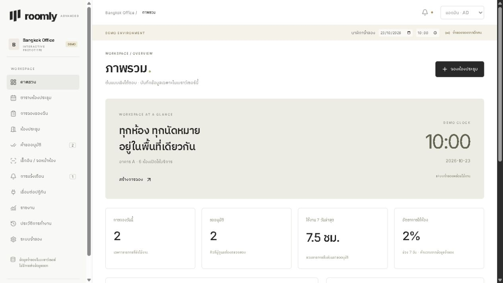

# Roomly



เว็บต้นแบบสำหรับจองห้องประชุม เขียนด้วย React และ Vite ทำไว้ลองขั้นตอนตั้งแต่เลือกห้อง จองเวลา ขออนุมัติ ไปจนถึงเช็กอินและดูรายงาน

ยังไม่มี backend ข้อมูลเก็บใน localStorage ของเบราว์เซอร์ เปิดมาก็ลองใช้ได้เลย ไม่ต้องตั้งฐานข้อมูลหรือล็อกอิน

## ลองเล่นอะไรได้บ้าง

- จอง แก้ไข ยกเลิก ตรวจเวลาชน ความจุ เวลาเปิด–ปิด และเวลาพักระหว่างการจอง
- จองซ้ำรายสัปดาห์สูงสุด 12 ครั้ง ถ้าครั้งใดชน ระบบจะไม่บันทึกทั้งชุด
- ตารางรายวันและรายสัปดาห์ ลากรายการเพื่อย้ายเวลา กด +30 เพื่อเพิ่มระยะเวลา หรือใช้ฟอร์มแก้ไขบนมือถือ
- สลับบทบาทสมาชิก ผู้ดูแลห้อง และแอดมินจากมุมขวาบน
- อนุมัติหรือปฏิเสธคำขอ พร้อมเหตุผลและประวัติการดำเนินการ
- จัดการอุปกรณ์ ความจุ วันปิดปรับปรุง และกติกาของแต่ละห้อง
- เช็กอินด้วยปุ่มจำลองสแกน QR เช็กเอาต์ และทดลองปล่อยห้องเมื่อไม่มาใช้งาน
- แจ้งเตือนในแอป รายงานการใช้ห้อง และส่งออก CSV / JSON
- เชื่อม Google Calendar / Outlook แบบจำลอง และดาวน์โหลดรายการจองเป็นไฟล์ .ics

## รันในเครื่อง

ใช้ Node.js 22 ขึ้นไป และ npm

```bash
npm install
npm run dev
```

เปิด URL ที่ Vite แสดง ปกติคือ http://127.0.0.1:5173

```bash
npm test
npm run build
npm run preview
```

## ลองขั้นตอนครบ ๆ

1. ใช้บทบาทสมาชิก จอง The Boardroom ในวันถัดไป ห้องนี้ต้องรออนุมัติ
2. เปลี่ยนเป็นผู้ดูแลห้อง เปิดคำขออนุมัติ แล้วอนุมัติรายการนั้น
3. ตั้งวันที่และเวลาในแถบนาฬิกาจำลองให้ตรงกับนัดหมาย
4. เข้าเช็กอิน / จอหน้าห้อง เลือกห้อง เปิด QR แล้วกดจำลองสแกน
5. เช็กเอาต์ แล้วเปิดรายงานและประวัติการทำงาน

ถ้าจะลองกรณีไม่มาใช้งาน ให้มีรายการยืนยันแล้วแต่ยังไม่เช็กอิน เลื่อนนาฬิกาจำลองให้เลยเวลาเริ่ม 15 นาที แล้วกดตรวจและปล่อยห้องที่ไม่มา ระบบไม่ได้รันงานเบื้องหลังเอง

แอดมินรีเซ็ตข้อมูลได้ในเมนูระบบจำลอง ปุ่มจำลองจองจากอีกคนใช้เพิ่มนัดหมายของผู้ใช้อื่นให้เห็นในตาราง

## ส่วนที่ยังเป็นของจำลอง

การสลับบทบาทไม่ใช่ระบบล็อกอิน และไม่ได้ป้องกันคนที่เปิด DevTools ได้ การอนุมัติและตรวจเวลาชนทำในหน้าเว็บ จึงยังใช้แทนระบบจองร่วมกันในองค์กรไม่ได้

Google / Outlook / Meet / Teams เป็นสถานะจำลอง ไม่มี OAuth และไม่สร้างกิจกรรมหรือห้องประชุมออนไลน์จริง การแจ้งเตือนไม่ส่งอีเมลหรือ push ส่วน QR เก็บรหัสเดโม ไม่ใช่ลิงก์เช็กอินผ่านมือถือ

ข้อมูลอัปเดตข้ามแท็บบน origin เดียวกันได้ แต่ไม่ซิงก์ข้ามเครื่องและไม่มี transaction ป้องกันสองแท็บเขียนพร้อมกัน ล้างข้อมูลเว็บไซต์แล้วรายการจะหาย เวลาใช้ timezone ของเครื่อง ควรตั้งเป็นประเทศไทยตอนทดลอง

## โค้ดอยู่ตรงไหน

| ไฟล์ | หน้าที่ |
| --- | --- |
| src/advanced-app.jsx | หน้าหลัก การเปลี่ยนสถานะ และข้อมูลในเบราว์เซอร์ |
| src/advanced-pages.jsx | ตาราง ห้อง อนุมัติ เช็กอิน รายงาน และการเชื่อมต่อ |
| src/advanced-ui.jsx | ฟอร์มจองและฟอร์มจัดการห้อง |
| src/mock-model.js | ข้อมูลตัวอย่าง สิทธิ์ กติกาจองซ้ำ และรายงาน |
| src/mock-model.test.js | ทดสอบกติกาของต้นแบบ Advanced |
| src/components/ | ปฏิทินและ timeline |

ถ้าจะทำเป็นระบบจริง ควรเริ่มจากย้ายข้อมูลและการตรวจเวลาชนไป backend แล้วเพิ่ม authentication และ permission ฝั่งเซิร์ฟเวอร์ ก่อนต่อ API ปฏิทินและระบบแจ้งเตือน

## ที่มาของคอมโพเนนต์

ใช้ Calendar Scheduler และ Daily Timeline Scheduler ของ Ruixen UI จาก [21st.dev](https://21st.dev/@ruixen.ui) มาปรับ ส่วนโครงหน้าและกติกาธุรกิจเขียนเพิ่ม รายละเอียดอยู่ใน src/vendor/21st/README.md ซอร์สอ้างอิงต้นฉบับที่ต้องเข้าบัญชีเก็บไว้เฉพาะในเครื่อง ไม่รวมใน Git

รูปห้องมาจาก Unsplash ฟอนต์จาก Google Fonts ทั้งสองส่วนต้องใช้อินเทอร์เน็ต ไอคอนใช้ Lucide และ QR ใช้ qrcode.react

โปรเจกต์นี้ทำร่วมกับ Codex โดยผู้ใช้กำหนดฟีเจอร์และทิศทางดีไซน์ ใช้ลอง flow และพัฒนาต่อได้ แต่ยังไม่ควรใช้เก็บการจองจริง
